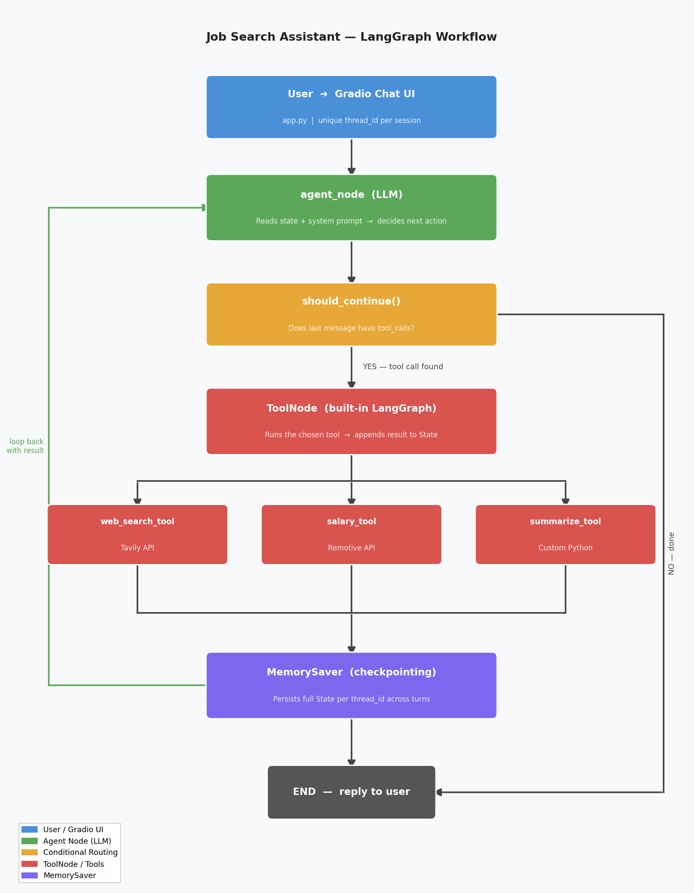

# Job Search Assistant

An agentic AI assistant that helps users find jobs, research salaries, and understand job descriptions. Built with LangChain, LangGraph, and Gradio as a university assignment demonstrating agentic AI concepts.

---

## What it does

- **Find job listings** — searches the web for current job postings using Tavily
- **Research salaries** — fetches real salary data from the Remotive API
- **Summarize job descriptions** — converts long job postings into clean bullet points
- **Multi-turn conversation** — remembers context across messages within a session

---

## Architecture

```
User (browser)
    │
    ▼
Gradio Chat UI  (app.py)
    │  passes message + thread_id
    ▼
LangGraph StateGraph  (agent.py)
    │
    ├── [Entry] agent_node
    │       LLM reads conversation history + system prompt
    │       Decides: respond directly OR call a tool
    │
    ├── [Conditional Edge] should_continue()
    │       tool_calls found? ──YES──► ToolNode
    │                         ──NO───► END
    │
    ├── ToolNode (built-in LangGraph)
    │       Runs the requested tool from tools.py
    │       Appends result back to State
    │       └──► loops back to agent_node
    │
    └── MemorySaver
            Checkpoints full conversation State per thread_id
            Enables multi-turn memory across messages
```

### Key concepts

| Concept | Role in this project |
|---------|---------------------|
| **State** (`MessagesState`) | Short-term notepad — the growing list of messages for one run |
| **MemorySaver** | Persists State checkpoints by `thread_id` across conversation turns |
| **Conditional routing** | `should_continue()` decides whether to call a tool or finish |
| **ToolNode** | LangGraph's built-in node that executes tool calls and returns results |
| **thread_id** | Unique per Gradio session — keeps multiple users' memories separate |

---

## Tools

### Tool 1 — `web_search_tool` (Tavily API)
- **Type**: External API
- **Purpose**: Searches the web for job listings, company info, and industry news
- **When used**: User asks about specific jobs or companies
- **API**: [Tavily](https://tavily.com) — search API built for AI agents

### Tool 2 — `salary_tool` (Remotive API)
- **Type**: External API
- **Purpose**: Fetches salary ranges from real remote job listings
- **When used**: User asks about compensation for a specific role
- **API**: [Remotive](https://remotive.com/api/remote-jobs) — free, no key required

### Tool 3 — `summarize_tool` (Custom Python)
- **Type**: Custom Python tool
- **Purpose**: Summarizes a job description into structured bullet points
- **When used**: User pastes a job description and asks for a summary
- **Implementation**: Calls the LLM internally with a structured prompt — no external API

---

## Project structure

```
job_assistant/
├── .env                  ← API keys (never committed)
├── .gitignore
├── requirements.txt
├── tools.py              ← Three tools with @tool decorator
├── agent.py              ← LangGraph StateGraph, nodes, edges, MemorySaver
├── app.py                ← Gradio chat interface
├── test_setup.py         ← Environment verification script
├── docs/
│   ├── workflow.png      ← Workflow diagram (assignment deliverable)
│   ├── ARCHITECTURE.md
│   ├── DECISIONS.md
│   └── PROGRESS.md
└── README.md
```

---

## Setup

### 1. Clone and install dependencies

```bash
git clone <your-repo-url>
cd job_assistant
pip install -r requirements.txt
```

### 2. Configure API keys

Copy `.env.example` to `.env` and fill in your keys:

```
OPENAI_API_KEY=sk-...
TAVILY_API_KEY=tvly-...
```

- **OpenAI key**: https://platform.openai.com/api-keys
- **Tavily key**: https://app.tavily.com (free tier: 1,000 searches/month)

### 3. Verify setup

```bash
python test_setup.py
```

Expected output:
```
OpenAI key found: YES
Tavily key found: YES
LLM responded: Hello!
Tavily returned 5 results

All good! Setup complete.
```

### 4. Run the app

```bash
python app.py
```

Open your browser at `http://127.0.0.1:7860`

---

## Example prompts

| Prompt | Tool triggered |
|--------|---------------|
| *Find me remote Python developer jobs* | `web_search_tool` |
| *What salary does a data scientist make?* | `salary_tool` |
| *What is Google's hiring culture like?* | `web_search_tool` |
| *What does a DevOps engineer earn?* | `salary_tool` |
| *(paste job description) Summarize this* | `summarize_tool` |
| *Tell me more about the first result* | Memory — no tool needed |

---

## LangGraph workflow diagram



---

## Tech stack

| Package | Role |
|---------|------|
| `langchain` | Base toolkit, `@tool` decorator, prompt templates |
| `langchain-openai` | `ChatOpenAI` — GPT-4o-mini as the LLM |
| `langgraph` | `StateGraph`, `ToolNode`, `MemorySaver`, `END` |
| `tavily-python` | Tool 1 — Tavily web search API |
| `requests` | Tool 2 — Remotive salary API |
| `gradio` | Browser chat UI |
| `python-dotenv` | Loads `.env` API keys safely |

---

## Assignment requirements checklist

- [x] Minimum 3 tools (2 external API + 1 custom Python)
- [x] LangGraph workflow with State, Nodes, Edges, Conditional routing, ToolNode
- [x] Memory / checkpointing with MemorySaver
- [x] Gradio chat interface
- [x] Multi-turn conversation capability
